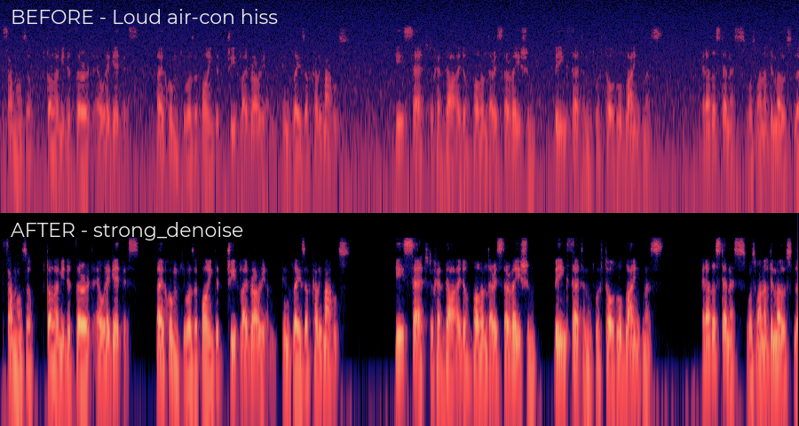
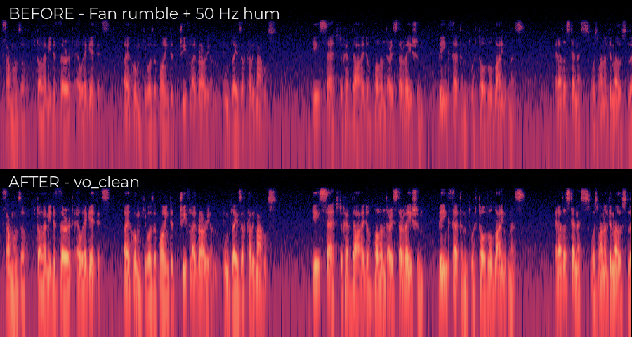
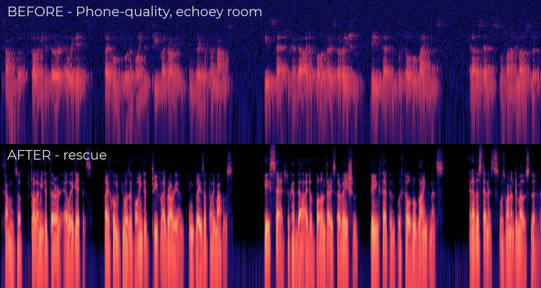

# EmClarity

**Clean up voice recordings on your own PC: drag, drop, done.**

EmClarity removes background noise, hum, hiss, music and echo from voiceovers, talking-head videos and
podcasts. It does the same job as Adobe Podcast *Enhance Speech*, but it runs **locally on your
NVIDIA GPU** with open-source AI models. There are no uploads, no daily limits and no subscription, and
it can process a whole folder in one go.



---

## Why this exists

Adobe Podcast Enhance Speech is great, but:

- it's **cloud-only**: client audio gets uploaded to a third party
- the free tier has **length and daily caps**; sliders and bulk upload are paid
- it always **rebuilds the voice**, which can make decent recordings sound slightly synthetic

EmClarity keeps everything on your machine and gives you a choice. **Gentle denoising keeps the real
voice** for recordings that are already decent, and a **full voice rebuild** ("Rescue") is there for
recordings that are genuinely bad.

## What it's for

| Good fit | Not the right tool |
|---|---|
| Voiceover and narration takes | Music production / mastering music |
| Talking-head, HeyGen / Chroma-key avatar takes | Separating two people talking over each other |
| Podcast / interview tracks | Real-time use during a live call (it processes files) |
| Phone or laptop-mic recordings that need rescuing | Changing *who* the voice sounds like |

---

## Quick start

### 1. Install (once)

Requirements: **Windows 10/11**, **Python 3.10+** on PATH ([python.org](https://www.python.org/downloads/), tick
*"Add to PATH"*), an **NVIDIA GPU** (it runs on CPU too, much slower), and about **9 GB** of free disk space.

```
git clone https://github.com/enjmag/EmClarity.git
cd EmClarity
install.bat
```

`install.bat` builds everything **inside the EmClarity folder** (`.venv`, `bin`, `models`) and downloads the
AI models. It takes 5–15 minutes, depending on your connection. To uninstall, delete the folder.

Optional second rebuild engine for A/B comparison (+6 GB): `install.bat -WithResemble`

### 2. Use it

**Drag audio or video files, or a whole folder, onto `Enhance.bat`**, then press a number:

```
 1  VO Clean         gentle denoise, voice untouched (default)
 2  Strong Denoise   removes all steady noise, voice untouched
 3  Noisy Room       music/TV/crowd behind the voice (+ saves background)
 4  Rescue           rebuilds the voice - ONLY for bad recordings
 5  Rescue Resemble  alternative rebuild for A/B (optional engine)
 6  Compare          run 1, 2 and 4 for side-by-side listening
```

If you don't press anything, **VO Clean** starts after 15 seconds.

### 3. Get the result

Each cleaned file is saved **next to the original**:

```
take3.wav  →  take3_emclarity_vo_clean.wav
```

Output is a 48 kHz, 24-bit WAV at −16 LUFS, **lined up sample-for-sample with the original**. In Premiere,
drop it on the track under the original and swap; lip sync stays frame-exact.

---

## Which preset should I use?

```
Is the recording basically fine, just some background noise?
 ├─ yes → 1 VO Clean        (still hear noise? → 2 Strong Denoise)
 └─ no
     ├─ music / TV / people talking behind the voice → 3 Noisy Room
     └─ phone-quality, muffled, echoey, laptop mic   → 4 Rescue
```

| # | Preset | What runs | Use for |
|---|---|---|---|
| 1 | `vo_clean` | DeepFilterNet, max 12 dB removed | Decent VO / talking head. **Voice untouched.** |
| 2 | `strong_denoise` | DeepFilterNet, full | Fans, AC, hiss, hum. **Voice untouched.** |
| 3 | `noisy_room` | Demucs separation → DeepFilterNet | Music/TV/crowd behind the voice. Also saves `_background.wav`. |
| 4 | `rescue` | DeepFilterNet → **Sidon voice rebuild** | **Bad recordings only.** Regenerates a studio voice. |
| 5 | `rescue_resemble` | DeepFilterNet → **Resemble Enhance** | A second opinion on a rescue. |
| 6 | *Compare* | runs 1, 2 and 4 | Not sure? Listen to all three. |

---

## Samples

All samples use a **public-domain** LibriVox reading (*"Eratosthenes"*, Short Nonfiction Collection
Vol. 083, [Public Domain Mark](https://archive.org/details/snf083_2106_librivox)), damaged on purpose and then
cleaned by EmClarity. Download the MP3s to listen; GitHub doesn't play audio inline.

Reference: [clean original](samples/0_clean_original.mp3)

### 1 · Fan rumble + 50 Hz hum → `vo_clean`
[Before](samples/1_home_office_before.mp3) · [After](samples/1_home_office_after_vo_clean.mp3)



### 2 · Loud air-con hiss → `strong_denoise`
[Before](samples/2_loud_ac_before.mp3) · [After](samples/2_loud_ac_after_strong_denoise.mp3)


### 3 · Phone-quality, echoey room → `rescue`
[Before](samples/3_bad_phone_echo_before.mp3) · [After](samples/3_bad_phone_echo_after_rescue.mp3)



*Spectrograms: time left to right, pitch bottom to top, brightness = loudness. Noise shows up as haze
between the words; echo shows up as smearing after each word.*

To rebuild the samples: `.venv\Scripts\python samples\make_samples.py`

---

## ⚠️ Important notes

1. **Don't use Rescue on recordings that are already decent.** The voice rebuild (Sidon / Resemble)
   regenerates the voice with a neural vocoder. On a decent recording it adds a slight warble and a
   metallic "s" shimmer (measured: ~10 % more frame-to-frame warble, synthetic energy above 12 kHz),
   which sounds a little robotic. That's why the default is gentle denoise. Use Rescue only when the
   source is clearly bad.
2. **Always listen before delivering.** Use *Compare* (6) when in doubt. Measurements can't replace ears.
3. **Never commit client audio to this repo.** `.gitignore` blocks `.wav/.mp3/.mp4` everywhere except
   `samples/`, and `samples/` must only ever contain public-domain or self-recorded audio.
4. **It's private and offline.** After installing, `Enhance.bat` runs with `HF_HUB_OFFLINE=1`; no audio or
   data leaves your PC.
5. **Commercial use is OK.** Every model used is MIT or Apache-2.0 (see *Licences*). Don't swap in
   `DialogueSidon` or any other CC BY-NC model for client work; those are non-commercial only.
6. **Video files:** EmClarity outputs a WAV, which you replace the audio with in your editor. To also
   get an `.mp4` with the new audio, set `mux_video: true` in `presets.yaml`.
7. **Mono output.** The voice is processed and delivered in mono (normal for dialogue and VO).
8. **Re-running is safe.** Files with `_emclarity_` in the name are skipped, so you can drop the same
   folder again after adding new takes.

---

## How it works

Each preset is a chain of steps, defined in [`presets.yaml`](presets.yaml) (edit freely):

| Step | Engine | What it does |
|---|---|---|
| `separate` | [Demucs v4](https://github.com/facebookresearch/demucs) `htdemucs` | Splits voice from music / TV / crowd |
| `deepfilter` | [DeepFilterNet 3](https://github.com/Rikorose/DeepFilterNet) | Real-time-class noise removal; `atten_limit_db` caps how much is removed |
| `sidon` | [Sidon v0.1](https://github.com/sarulab-speech/Sidon) | Rebuilds a clean 48 kHz voice from w2v-BERT 2.0 speech features (comparable to Google's Miipher) |
| `resemble` | [Resemble Enhance](https://github.com/resemble-ai/resemble-enhance) | Alternative voice rebuild (optional) |
| master | ffmpeg `loudnorm` | Two-pass EBU R128 to −16 LUFS, −1.5 dBTP, 24-bit WAV |

`strength` on `sidon` / `resemble` works like Adobe's slider: `1.0` = fully rebuilt; `0.7` = 70 % rebuilt +
30 % of the voice from before that step.

Sidon's vocoder adds a fixed ~7.75 ms delay, which EmClarity removes so the output lines up with the input.

### Command line

```
.venv\Scripts\python -m emclarity --list
.venv\Scripts\python -m emclarity "D:\VO\take3.wav" -p strong_denoise
.venv\Scripts\python -m emclarity "D:\VO\Hook 2" -p vo_clean -o "D:\VO\Hook 2\clean"
```

Inputs: wav, mp3, m4a, flac, aac, ogg, mp4, mov, mkv … (it uses the first audio track).

### Measured on a real voiceover (33 s take, RTX 4070 Ti SUPER)

| Version | Noise floor | Warble vs original | Synthetic >12 kHz | Time |
|---|---|---|---|---|
| original | −32 dB | 1.00 | no | – |
| `vo_clean` (picked by ear) | −44 dB | 1.05 | no | ~3 s |
| `strong_denoise` | −70 dB | 1.02 | no | ~3 s |
| `rescue` (Sidon) | −55 dB | 1.11 | yes | ~12 s |
| `rescue_resemble` | −61 dB | 1.09 | yes | ~17 s |

---

## Troubleshooting

| Problem | Fix |
|---|---|
| `EmClarity is not installed yet` | Run `install.bat` first. |
| `Python 3.10+ is required` | Install Python from python.org with *Add to PATH* ticked, then re-run `install.bat`. |
| Very slow | You're on CPU. Check that `nvidia-smi` works and update your NVIDIA driver. |
| Result sounds robotic / metallic | You used Rescue on a decent recording. Use `vo_clean` or `strong_denoise`. |
| Still hear noise after VO Clean | Use `strong_denoise` (VO Clean deliberately leaves a little room tone). |
| Rescue preset says Resemble isn't installed | That's preset 5 only. Run `install.bat -WithResemble`. |

---

## Repo layout

```
Enhance.bat            drag-and-drop entry point (preset menu)
install.bat / .ps1     one-click installer (everything stays in this folder)
presets.yaml           preset chains - edit freely
emclarity/
  cli.py               command line / batch runner
  pipeline.py          runs a preset chain, blend + master
  audio.py             ffmpeg decode, loudnorm, video mux, alignment
  engines/             sidon, deepfilter, separate (demucs), resemble (+ isolated runner)
  fetch_models.py      pre-downloads weights into models/
samples/               public-domain before/after demos + make_samples.py
```

## Licences

EmClarity code: [MIT](LICENSE). Model weights are downloaded at install time and aren't stored in this repo.

| Component | Licence |
|---|---|
| Sidon v0.1, `sarulab-speech/sidon-v0.1` | MIT |
| w2v-BERT 2.0 feature extractor, `facebook/w2v-bert-2.0` | MIT |
| DeepFilterNet 3 (binary + model) | MIT or Apache-2.0 (dual) |
| Demucs v4 / htdemucs | MIT |
| Resemble Enhance (optional) | MIT |
| PyTorch | BSD-3-Clause |
| ffmpeg (via `imageio-ffmpeg`) | GPL/LGPL, run as a separate program, not linked |
| Sample audio (LibriVox) | Public Domain |

Resemble Enhance runs in its own environment (`envs\resemble`, torch 2.1.1) because it pins old versions.
Its training-only DeepSpeed dependency is replaced by an inert stub, so no compiler is needed.
